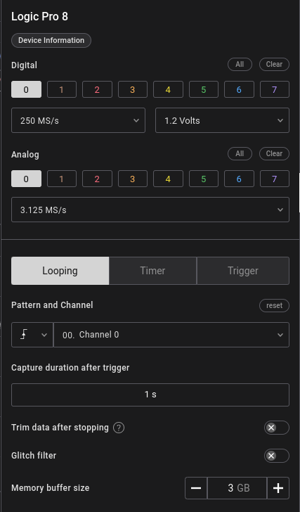
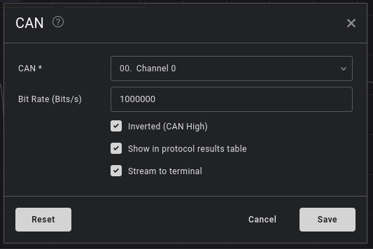
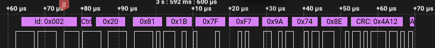
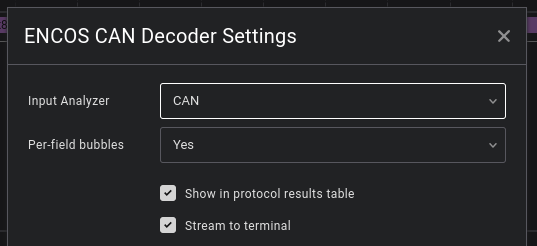
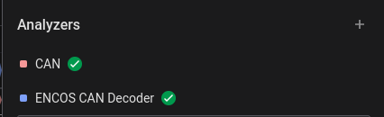
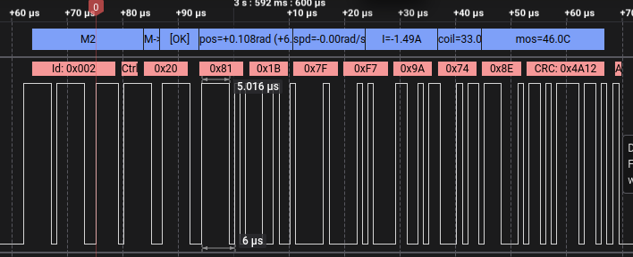

# ENCOS Motor Decoder

Do you want to decode the ENCOS CAN protocol that your robot is running?
Of course you do.

Now, using your handy [Saleae Logic Analyser](https://www.saleae.com/), you can. How neat.

## How do I use your funky tool?

### Step 1. Install Logic 2

Link:
[Saleae Logic 2](https://www.saleae.com/downloads)

### Step 2. Probe your signal.

Plug the CAN differential (High/Low) into the two signal pins of one channel on your Saleae.

### Step 3. Configure your channel

As shown below, I used channel 0 for my signal. I recorded both analog and digital version of my signal. Recording at 250 mega-samples per second and 1.2 volts for the digital and 3.125 mega-samples per second served me well. YMMV.

### Step 4. Configure CAN analyser

Saleae works on analysers, and this analyser works on analysing another analyser, namely the [CAN](https://en.wikipedia.org/wiki/CAN_bus) one. CAN is the method by which the motors speak to the subcontroller, ENCOS is the language they speak.

Add an analyser (the plus in the top RHS under the analyser menu, denoted by "1F")

Choose the channel you recorded to analyse for CAN.

Save it.

Provided you've recorded valid CAN and configured this analyser properly, you should see some CAN data above your binary data.

Notice how the CAN data says 0x1B and 0x7F instead of "hey motor go to this position"? That's what the next analyser is for.

Let's configure it.

### Step 5. Configure ENCOS analyser

Same deal, click the plus, add the ENCOS CAN Decoder (this one; if you can't find it, go to Find More Analysers and search for "ENCOS CAN Decoder").

Once you're configuring it, choose the CAN decoder we just configured together as the input of the ENCOS decoder.

Save it.

After this, you should see two analyzers configured. How good are you!

### Step 6. Look at your data

The output of the decoder might look something like this, for example:

You may notice that above the CAN data, we have ENCOS data that actually gives you motor information rather than standard bytes. You can see in the image above, Motor 2 (M2) talks to the host (M->H), says it's OK, and gives us the position and the current through it among others.

Congratulations! You've now configured the ENCOS decoder in Saleae.

## Contributions

Open a PR or [email me](mailto:miles@punchav.com).
